<p align="center">
  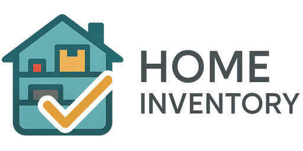
</p>

<h3 align="center">Know what you own and where it is, right inside Home Assistant.</h3>

<div align="center">


[](https://my.home-assistant.io/redirect/hacs_repository/?owner=SnipsC0&repository=test-readme&category=integration)

</div>

<p align="center">
  
</p>

A custom integration for Home Assistant that organizes your household inventory through a logical structure: **Rooms → Cupboards → Shelves → Organizers → Items**. An item can live in several places at once, each with its own quantity, expiry batches and photo. Includes secure local images, barcodes per variant, low stock and expiry alerts, QR/NFC links, a dedicated UI and sensors/events for automations.

---

## ✨ Features

<table>
<tr>
<td width="40%" valign="middle">

### Browse your home

Rooms → Cupboards → Shelves → Organizers → Items, with a photo on every card. Quick +/- buttons and low stock thresholds on every tracked item.

</td>
<td width="60%">

<picture>
  <source media="(prefers-color-scheme: dark)" srcset="https://raw.githubusercontent.com/SnipsC0/test-readme/main/docs/assets/screenshots/01-rooms-dark.png">
  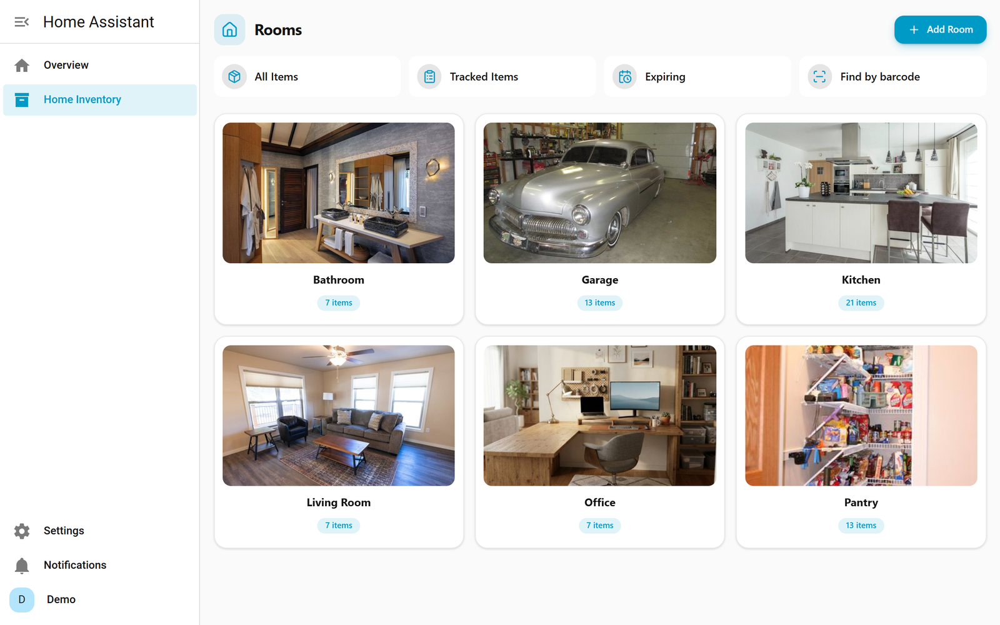
</picture>

</td>
</tr>
</table>

<table>
<tr>
<td width="60%">

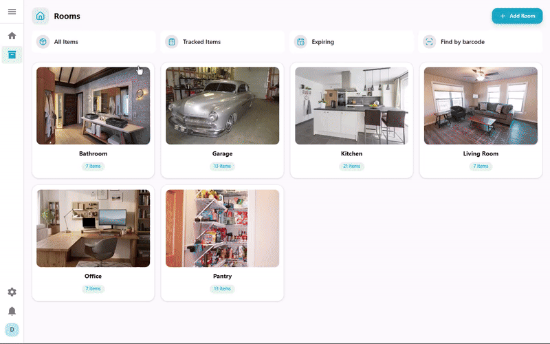

</td>
<td width="40%" valign="middle">

### One item, many places

The same item can sit in several locations, each with its own quantity, expiry batches and photo. Variants (e.g. a small jar) get their own rows and barcodes.

</td>
</tr>
</table>

<table>
<tr>
<td width="40%" valign="middle">

### Never throw food away

Expiration batches, a configurable warning window, an **Expiring** view, plus a sensor and an event for notifications.

</td>
<td width="60%">

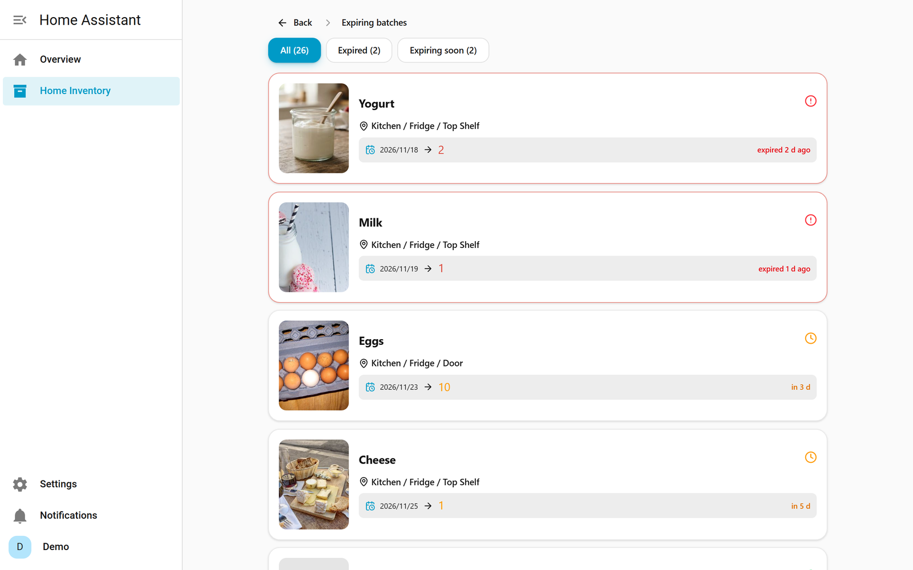

</td>
</tr>
</table>

<table>
<tr>
<td width="60%">

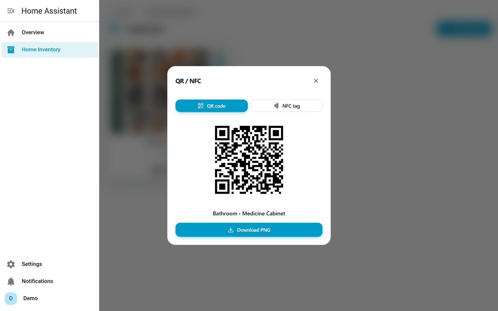

</td>
<td width="40%" valign="middle">

### QR codes and NFC tags

Cupboards and shelves have a QR / NFC dialog: a downloadable QR code and a deep link for any NFC tag. Links use IDs, so they survive renames.

</td>
</tr>
</table>

<table>
<tr>
<td width="40%" valign="middle">

### Safe deletes

A delete preview lists everything a cascade delete will remove (children, items, images) before you confirm.

</td>
<td width="60%">

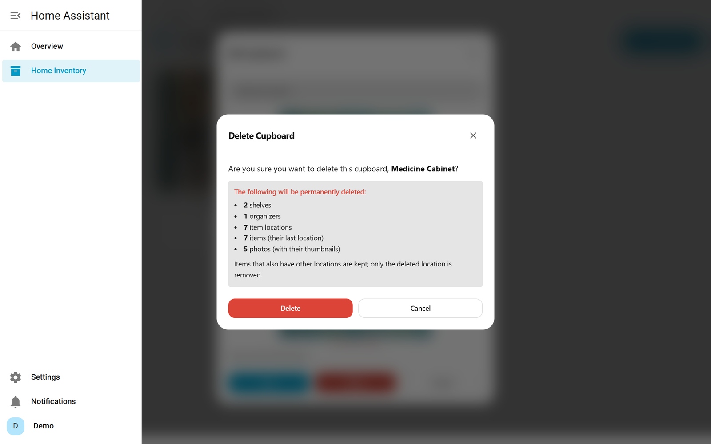

</td>
</tr>
</table>


### 📱 On your phone

<p align="center">
  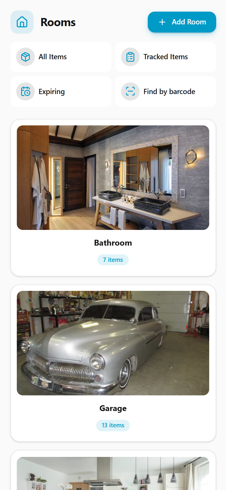
  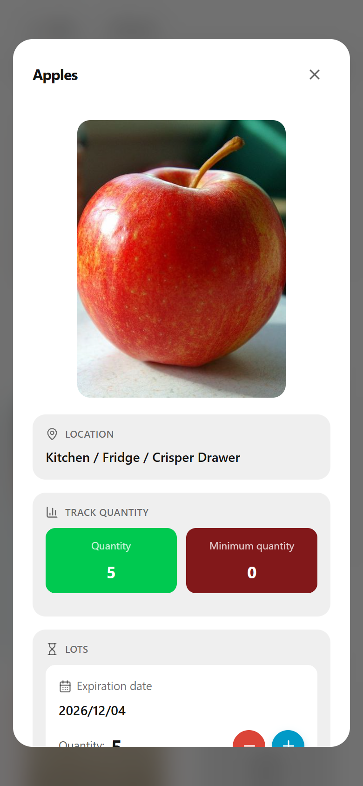
  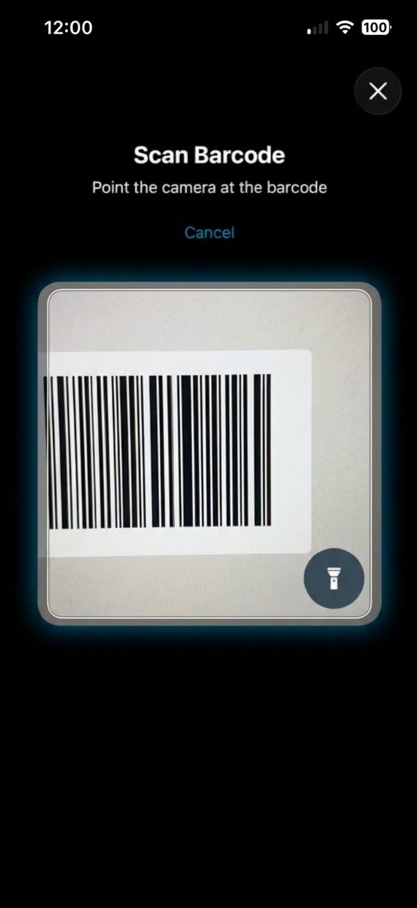
</p>

### And more

- **Barcode scanning**: native scanner of the Companion app, image upload or manual entry; **Find by barcode** in the header
- **Photos everywhere**: rooms, cupboards, shelves, organizers and every item location, with fast thumbnails
- **Secure images**: served via the authenticated API, NOT through the public `/local` directory
- **100% local**: no cloud, no telemetry (QR codes are generated locally too)
- **Dedicated UI**: sidebar panel, translated in English, German, Romanian and Russian, lazy loading for hundreds of items
- **Automation ready**: four sensors and two events for notifications, shopping lists, Discord, LED alerts, etc.

---

## 🚀 Installation

> **Requirements:** Home Assistant **2026.11.0** or newer. Older Home Assistant versions stay on **2.0.3**.

### 🟣 Marketplace (Custom Repository)

1. Open the **Marketplace** (the built-in successor of HACS) → **Integrations**
2. Click `⋮` (top right) → **Custom Repositories**
3. Enter `https://github.com/SnipsC0/Home-Inventory`, type **Integration**
4. Confirm, then click **Install** and restart Home Assistant
5. `Settings → Devices & Services → Add Integration → "Home Inventory"`

<details>
<summary>🔹 Manual installation</summary>

1. Download `home_inventory.zip` from the latest [GitHub release](https://github.com/SnipsC0/Home-Inventory/releases) (the frontend is already built) and extract it to `/config/custom_components/home_inventory`
2. Restart Home Assistant (`Settings → System → Restart`)
3. `Settings → Devices & Services → Add Integration → "Home Inventory"`

</details>

### ⚙️ Options

`Settings → Devices & Services → Home Inventory → Configure`:

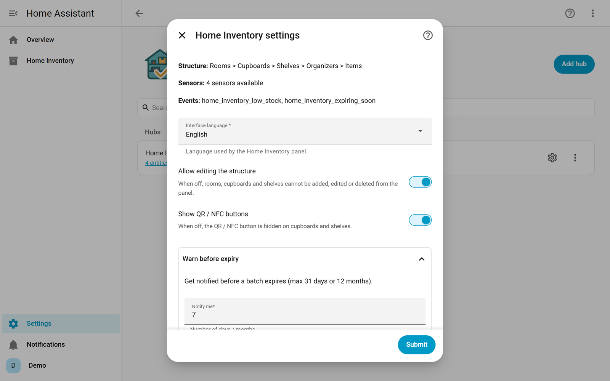

- **Interface language** (English / German / Romanian / Russian), used by the whole panel
- **Allow editing the structure**: when off, rooms, cupboards and shelves cannot be added, edited or deleted (items and organizers stay editable)
- **Warn before expiry**: 1-31 days or 1-12 months (default 7 days)

<details>
<summary>🔄 Upgrading from 2.x</summary>

The database is migrated to schema v2 automatically on first start. **A backup is created right before the migration**: `/config/data/home_inventory_backup.zip`, containing the database and all images. An existing backup is never overwritten (a timestamp is added to the new name), and if the backup fails the migration is not applied.

To roll back: stop Home Assistant and extract the zip into `/config/data/` (it contains the `home_inventory/` folder).

</details>

---

## 🖥 Using the panel

After installation, a **"Home Inventory"** panel appears in the sidebar. It is served through a secured API: images and data are only reachable when authenticated in Home Assistant.

- **Rooms → Cupboards → Shelves → Organizers**: browse and manage the hierarchy
- **All items**: every item with all its locations and a cumulative total; filter by location
- **Tracked items**: items with quantity tracking enabled
- **Expiring**: batches inside the warning window, already expired ones included
- **Find by barcode** (header): scan or type a barcode to jump straight to the item

Edit and delete actions are available via long press or right-click on any card. QR codes and NFC tags open a cupboard or shelf directly:

```
homeassistant://navigate/home_inventory?target=shelf&id=12
```

---

## 🔔 Automations

Four sensors and two events are available. Reference pages:

- [Sensors](docs/sensors.md): `total_items`, `low_stock`, `tracked_items`, `expiring_batches`
- [Events](docs/events.md): `home_inventory_low_stock`, `home_inventory_expiring_soon`
- [Automation examples](docs/automations.md): push notification, shopping list, Discord, LED, expiry

<table>
<tr>
<td width="55%" valign="top">

```yaml
automation:
  - alias: 'Low Stock Notification'
    trigger:
      - platform: event
        event_type: home_inventory_low_stock
    action:
      - service: notify.mobile_app_your_phone
        data:
          title: '⚠️ Low Stock: {{ trigger.event.data.name }}'
          message: >
            Quantity: {{ trigger.event.data.quantity }} / {{ trigger.event.data.min_quantity }}
            Location: {{ trigger.event.data.location }}
```

</td>
<td width="45%">

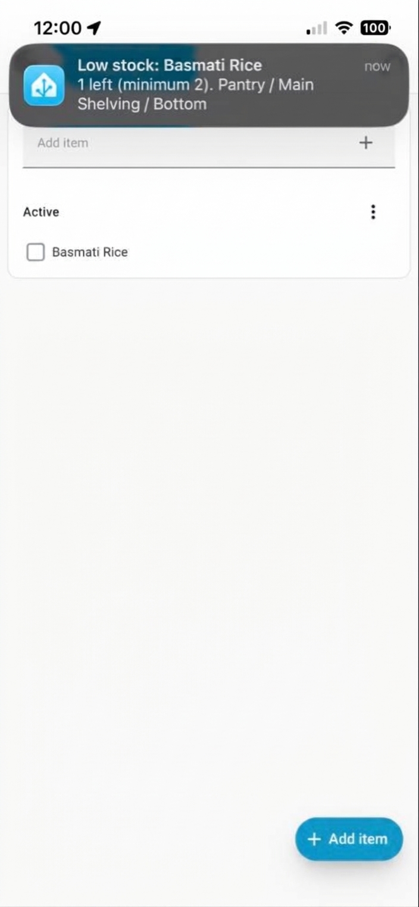

</td>
</tr>
</table>

---

## 🔐 Security & Privacy

- Images are NOT served through the public `/local` directory and require Home Assistant authentication
- 100% offline: no cloud synchronization, no telemetry, QR codes generated locally
- Compatible with Cloudflare / remote proxies
- Automatic backup before migrations: database and images zipped to `/config/data/home_inventory_backup.zip`

---

<details>
<summary>🛠 Usage tips</summary>

1. **Organize first, populate later**: set up rooms/cupboards/shelves before adding items
2. **Use quantity tracking** for consumables and set realistic minimum thresholds
3. **Leverage automations** for shopping lists, notifications and alerts
4. **Use aliases** so items are easier to search, and **take photos** to identify them
5. **Use variants** for different sizes/brands, each with its own barcode
6. **Add expiry dates** to food and medicine to get notified in time
7. **Label your furniture** with a QR code or NFC tag for one-tap access

</details>

---

## 📜 License

Distributed under the MIT License. You are free to modify and redistribute.

## ⭐ Support

If you find this project useful, a ⭐ on GitHub helps tremendously!
